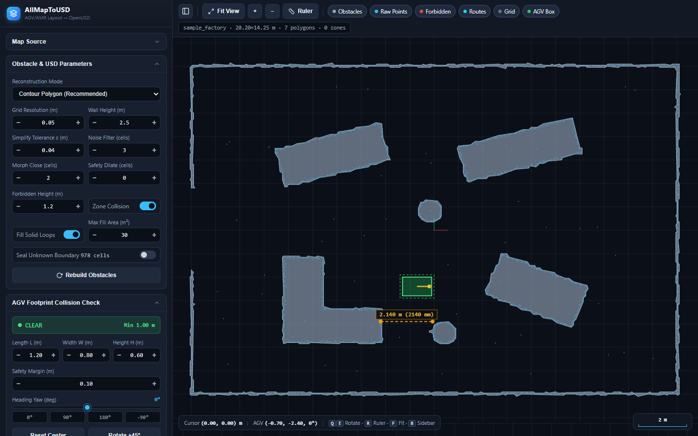
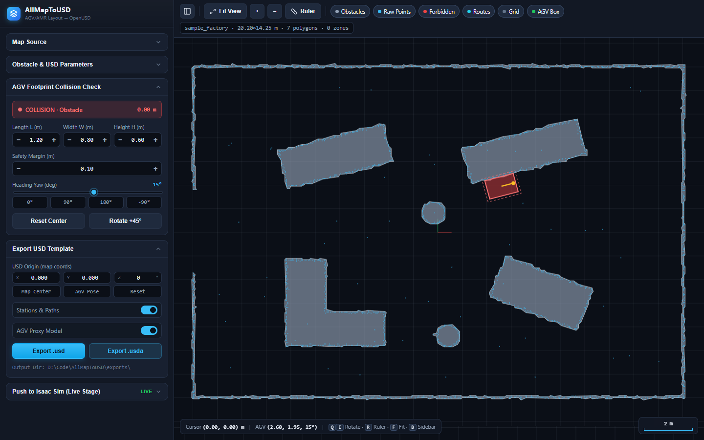
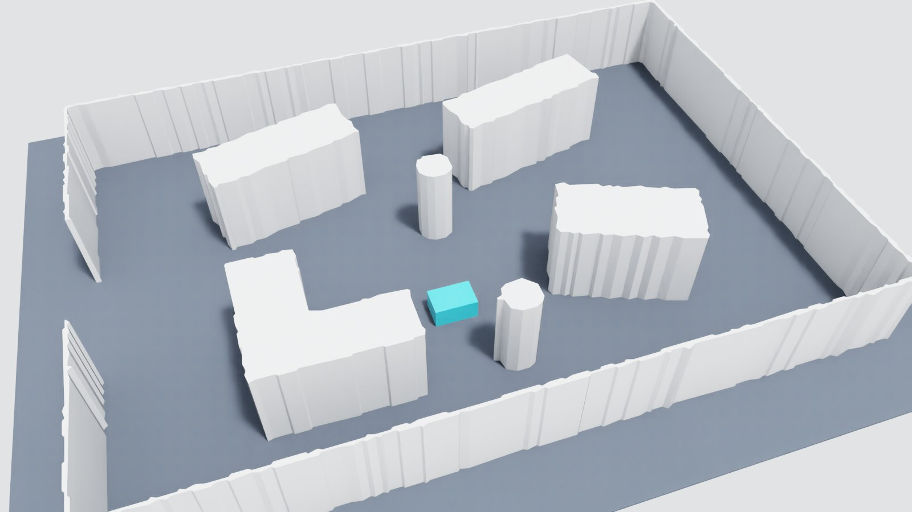

# AllMapToUSD

**AllMapToUSD** is a lightweight desktop & web engineering tool that converts AGV/AMR navigation maps from different robot controllers into unified, simulation-ready **OpenUSD (`.usd` / `.usda`)** obstacle environments—and pushes them directly into a live **NVIDIA Isaac Sim** stage.

It also includes a built-in **2D CAD Layout & Collision Inspector**, allowing engineers to measure aisle widths and test AGV footprint clearances even without launching Isaac Sim.

## Screenshots

The bundled noisy ROS sample (`sample_maps/ros_factory`) after reconstruction: raw occupancy points (blue dots) are traced into clean obstacle polygons (grey) ready for USD extrusion.


*Reconstruction parameters on the left; in the viewport the AGV footprint has clearance (`CLEAR · Min 1.00 m`) and the ruler measures a 2.14 m aisle.*


*The same AGV moved and rotated 15° into a rack is flagged `COLLISION`; the export panel sets the USD origin and whether stations/paths and the AGV proxy model are included.*


*The same sample after **Push to Isaac Sim**, referenced into a live Isaac Sim stage at `/World/AGV_Map`: walls and machines extruded to 2.5 m on a ground plane, with the AGV proxy box (cyan) at the checked pose.*

---

## Key Features

- **Unified Intermediate Format (`CanonicalMap`) + Pluggable Parsers**:
  - **SEER Robotics (`.smap`)**: Parses JSON `.smap` obstacle point clouds (`normalPosList`), line segments (`normalLineList`), forbidden zones (`advancedAreaList`), **stations** (`advancedPointList`) and **route paths** (`advancedCurveList`, Bezier-sampled).
  - **ROS / ROS 2 Nav2 (`.yaml` + `.pgm`/`.png`, or `.zip`)**: Parses standard `map_server` occupancy grids (`trinary` / `scale` / `raw` modes, `occupied_thresh` / `free_thresh`, origin yaw). Optional **Seal Unknown Boundary** (a rebuild option under `Obstacle & USD Parameters`, CLI `--seal-unknown`) turns unknown cells bordering free space—and free cells on the map edge—into walls, closing open SLAM frontiers in the preview, the exported USD and the Isaac Sim push.
  - **CAD / SICK SMET (`.dxf`)**: Parses vector floorplans (`LINE`, `LWPOLYLINE` incl. arc bulges, `POLYLINE`, `CIRCLE`, `ARC`, `ELLIPSE`, `SPLINE`, and block references `INSERT`) with automatic `$INSUNITS` detection or manual unit override. **Per-layer include/exclude and extrusion height** (e.g. walls 3 m, racks 2 m, drop `TEXT` / `DIM`).
  - **Image Floorplan / SICK Export (`.png` / `.pgm` / `.bmp`)**: Parses standalone raster map exports using a configurable `Image Resolution (m/px)`.
  - **Explicit Format / Controller Selector**: Choose the exact controller/format from the `Map Source` dropdown (or `Auto Detect`) instead of relying solely on file extensions.
  - **Extensible**: Add any new controller format by implementing a single `MapParser` class and registering it in `ParserRegistry`.
- **Smart 3D Obstacle Reconstruction**:
  - **Contour Polygon (Default)**: Traces exact boundaries with gap-tolerant solid cavity filling and closed-loop Douglas-Peucker simplification—faithfully preserving circular columns, curved walls, tilted racks, L-shaped machines, and local protrusions.
  - **Axis-Aligned Grid Merge (AABB)**: Collapses occupied cells into minimal axis-aligned `UsdGeom.Cube` wall blocks.
  - **Forbidden Zones**: Extruded as semi-transparent red collision volumes (`UsdPhysics.CollisionAPI`) so no-go areas are immediately distinguishable from physical walls.
- **Pure-Python OpenUSD Export (`usd-core`)**:
  - Generates Z-up, 1-meter-unit `.usd` / `.usda` stages offline—no Isaac Sim installation required to export.
  - Includes `PhysicsScene`, high-contrast industrial floor vs. walls, soft overhead lighting (`AmbientDome` + `OverheadKey`), static triangle-mesh colliders (`UsdPhysics.CollisionAPI`, approximation `none`), and an optional parametric `AGV_Proxy` footprint model.
  - Stations (posed Xforms) and route paths (`BasisCurves`) under `/World/Map/Navigation` as non-colliding markers.
  - Configurable **output origin & heading** (`Map Center` / `AGV Pose` presets) to re-express map coordinates in the USD frame.
- **Direct Live Push to NVIDIA Isaac Sim**:
  - Connects to Isaac Sim's `isaacsim.code_editor.python_server` (default port `8226`).
  - Supports both **local** (`127.0.0.1`) and **remote Linux hosts** (enter the real remote IP directly—AllMapToUSD automatically establishes and reuses an SSH tunnel if the remote server is bound to loopback).
  - Mounts as a live **Reference** (`/World/AGV_Map`) inside the currently open stage (auto-reloading on updates without disturbing existing robots/sensors) or opens as a new stage.
  - Large maps (> 8 MB by default, `transfer_mode` / `inline_limit_mb` in `isaac_config.json`) are delivered as files—direct copy on `127.0.0.1`, `ssh mkdir` + `scp` for remote hosts—instead of being embedded in the python cell.
- **Built-in 2D CAD Clearance & Collision Inspector**:
  - Smooth zoom/pan, dynamic metric scale bar, layer visibility toggles, 2-point aisle **Ruler** (`m` / `mm`), and a draggable/rotatable AGV footprint box with real-time **CLEAR / TOO CLOSE / COLLISION** status against a configurable **safety margin**.
- **Command-line batch conversion** (`allmaptousd convert`) for CI / scripted pipelines.

---

## Architecture

```text
Vendor Maps                       Canonical IR & Core                       Outputs
───────────────                   ────────────────────────────              ──────────────────────────
SEER (.smap/.json)    ──┐        ┌─ CanonicalMap (numpy dataclass)       ┌─► 2D CAD Collision Viewer
ROS (.yaml+.pgm/.zip) ──┤        ├─► Rasterize & Denoise (OpenCV)        ├─► Local .usd / .usda Export
CAD / SICK (.dxf)     ──┼─► Parse├─► Gap-Tolerant Solid Cavity Fill      ├─► Live Isaac Sim Stage Push
Image (.png/.pgm/.bmp)──┤        └─► Contour Polygon / AABB Rebuild      │   (Direct TCP or Auto SSH Tunnel)
Future Parsers (...)  ──┘            (per extrusion-height group)        └─► CLI batch conversion
```

---

## Installation & Quick Start

### Prerequisites
- **Python 3.11+** for Windows (tested on 3.12, Windows 10/11). Use the [python.org installer](https://www.python.org/downloads/windows/) with its default options (they include `tkinter`, used by the setup window).
- *(Optional, for remote Isaac Sim push)* OpenSSH client (`ssh`) configured with key-based login in `~/.ssh/config`.

### Start the App: `start_app.cmd` (single entry point)
Double-click **`start_app.cmd`**. That is all; there is no separate setup step:

- **First run**: a small setup window shows each step with a progress bar (create `.venv` → update pip → download and install packages → check the installation), then starts the app. It takes about 1 minute with a warm pip cache, longer on a first download (`usd-core` and OpenCV are large). If a step fails, the window offers **Retry** and **Open log** (`setup.log`).
- **Later runs**: the app starts directly (native WebView window).
- **After an update**: when `pyproject.toml` changes (new dependencies), setup runs again automatically.
- **No Python found**: a message box explains what is missing and opens the python.org download page.

Arguments are passed through to `run_app.py`, e.g. `start_app.cmd --browser`. `start_app.cmd --force-setup` re-runs the setup window (repairs a damaged `.venv`). The app's own output is written to `app.log`.

### Manual / Developer Setup
```powershell
python -m venv .venv
.\.venv\Scripts\pip.exe install -r requirements.txt   # = pip install -e ".[desktop,dev]"

.\.venv\Scripts\python.exe run_app.py                  # native desktop window (pywebview)
.\.venv\Scripts\python.exe run_app.py --browser        # default web browser
.\.venv\Scripts\python.exe run_app.py --headless --port 8765   # FastAPI server only
```

Dependencies are declared once in `pyproject.toml`; `requirements.txt` installs the package in editable mode with the `desktop` (pywebview) and `dev` (pytest, ruff, httpx) extras. `start_app.cmd` installs only the `desktop` extra.

---

## Usage Workflow

### 1. Load a Map (`Map Source`)
- Select the controller / format from **`Map Format / Controller`** (`Auto Detect`, `SEER Robotics`, `ROS / Nav2`, `CAD / SICK SMET (.dxf)`, or `Image Floorplan / SICK Export`).
- Drag and drop (or click to browse) your map files. When using `.dxf` or standalone `.png`/`.pgm` images, adjust `DXF Drawing Units` or `Image Resolution (m/px)` as needed.
- To test immediately without real map files, click **`Sample: ROS.yaml`** (realistic noisy LiDAR SLAM occupancy grid with tilted racks, L-machine, and round pillars).

### 2. Inspect & Measure in 2D Viewport
- **Pan**: Left-drag on empty space.
- **Zoom**: Mouse wheel (or `+` / `−` buttons, press **`F`** to Fit View).
- **Measure Aisles**: Click **`Ruler`** (or press **`R`**), then click/drag between any two points to read exact distance in meters and millimeters.
- **Toggle Layers**: Click layer pills in the top toolbar (`Obstacles`, `Raw Points`, `Forbidden`, `Routes`, `Grid`, `AGV Box`).
- **Toggle Sidebar**: Click the top-left sidebar icon or press **`B`** (drag the right edge of the sidebar to resize).

### 3. Tune Obstacle Reconstruction (`Obstacle & USD Parameters`)
- **Reconstruction Mode**:
  - `Contour Polygon (Recommended)`: Preserves curves, round pillars, and local protrusions. Tune **`Simplify Tolerance ε (m)`** (smaller = finer detail, larger = fewer vertices).
  - `Axis-Aligned Grid Merge (AABB)`: Outputs pure `UsdGeom.Cube` blocks.
- **Solid Cavity Filling**: Keep **`Fill Solid Loops`** enabled so hollow laser-scanned racks and pillars become solid volumes (adjust **`Max Fill Area (m²)`** for very large storage blocks).
  - ⚠ Any fully enclosed area smaller than `Max Fill Area` is filled—**including small closed rooms** (offices, cages, charging bays without a scanned doorway). Lower the limit or disable the switch if such rooms must stay drivable.
- **Seal Unknown Boundary** (occupancy grids only; shows the frontier cell count): turns unknown space bordering the scanned free area into walls, so open SLAM frontiers and doorways leading into unscanned space are closed in the preview, export and Isaac push.
- Click **`Rebuild Obstacles`** to update the preview immediately.

### 4. Verify AGV Clearance (`AGV Footprint Collision Check`)
- Expand **`AGV Footprint Collision Check`** and enter your vehicle's **`Length L (m)`**, **`Width W (m)`**, and **`Height H (m)`**.
- Drag the green AGV box directly on the 2D canvas and rotate with **`Q` / `E`**, **`Shift + Scroll`**, or the yaw slider/preset chips (`0° / 90° / 180° / -90°`).
- The status banner updates in real time with **`CLEAR` + minimum clearance distance** or **`COLLISION`** (highlighting red on overlap).

### 5. Export USD (`Export USD Template`)
- Click **`Export .usd`** (binary Crate, fastest for Isaac Sim) or **`Export .usda`** (human-readable ASCII).
- Exported files are saved automatically to **`exports/`** (full path displayed below the buttons) and downloaded via the app.
- Toggle **`Stations & Paths`** and **`AGV Proxy Model`** to include or omit the navigation markers and the `/World/TestVehicle` footprint proxy.

### 6. Push Directly to Live Isaac Sim (`Push to Isaac Sim (Live Stage)`)
1. Launch Isaac Sim with the Python code-editor server enabled:
   ```bash
   ./isaac-sim.sh --enable isaacsim.code_editor.python_server
   ```
2. In AllMapToUSD, expand **`Push to Isaac Sim (Live Stage)`**:
   - **Isaac Sim Host IP**: Use `127.0.0.1` for local Isaac Sim, or enter your remote Linux workstation IP (e.g., `192.168.3.158`).
   - **Port**: Default `8226`.
   - **Stage Mode**:
     - `Reference in Current USD`: Mounts/reloads the map at **`Target Prim Path`** (default `/World/AGV_Map`) inside your active scene without touching existing robots or cameras.
     - `Open as New Stage`: Opens the generated USD as the active stage.
3. Click **`Test Connection`** to verify the active stage, then click **`Push to Isaac Sim`**.

---

## Command Line (Batch Conversion)

```powershell
.\.venv\Scripts\pip.exe install -e .          # registers the `allmaptousd` command
allmaptousd formats
allmaptousd convert sample_maps\sample_factory.yaml -o out\factory.usd
allmaptousd convert plant.dxf -o plant.usda --dxf-units mm --layer-height RACK=2.0 --exclude-layer TEXT
allmaptousd convert site.smap -o site.usd --config build.json --origin 12.5 -3 90 --no-vehicle
```

Without installing, `python -m allmaptousd ...` works with `src` on `PYTHONPATH`. `--config` accepts a `BuildConfig` JSON (the same fields the UI sends); CLI flags override it.

---

## Code Layout (Developer Guide)

A small ports-and-adapters layout keeps the core independent of file formats and front ends:

| Role | Module | Responsibility |
|------|--------|----------------|
| Core model | `models.py` | `CanonicalMap` (numpy IR), `BuildConfig`, `IsaacSimConfig` |
| Core logic | `geometry/reconstruct.py` | Rasterize, denoise, fill, contour / AABB rebuild |
| Application service | `pipeline.py` | `MapSession`: parse → rebuild → export, used by every front end |
| Driving adapters | `web/server.py`, `cli.py` | FastAPI UI backend and batch CLI (thin wrappers around `MapSession`) |
| Web UI | `web/static/index.html`, `app.css`, `js/*.js` | Plain HTML/CSS/JS, no build step. Scripts load in order and share one global scope: `core` → `collision` → `render` → `controls` → `api` → `main` |
| Input adapters (port: `MapParser`) | `parsers/*.py` | One parser per vendor format, chosen by `ParserRegistry` |
| Output adapters | `exporters/usd_exporter.py`, `exporters/isaac_connector.py` | USD stage writer, live Isaac Sim push |

### Adding a New Map Format

Parsers are injected through `ParserRegistry` (`src/allmaptousd/parsers/base.py`):

1. Create a new parser class in `src/allmaptousd/parsers/` implementing `MapParser`:
   - `format_id: str`
   - `display_name: str`
   - `supported_extensions: tuple[str, ...]`
   - `can_parse(bundle: MapInputBundle) -> bool`
   - `parse(bundle: MapInputBundle) -> CanonicalMap`
2. Register your parser in `create_default_registry()` (`src/allmaptousd/parsers/__init__.py`).

All reconstruction, 2D collision checks, USD export, and Isaac Sim Live Push work automatically with zero changes.

---

## Running Tests

```powershell
.\.venv\Scripts\python.exe -m ruff check .
.\.venv\Scripts\python.exe -m pytest -v
```

GitHub Actions (`.github/workflows/ci.yml`) runs the same lint + tests on Ubuntu and Windows with Python 3.11 / 3.12.

---

## License

This project is licensed under the [MIT License](LICENSE).
